# Extended Mind

A plain-text folder that keeps one person in charge of their AI agent across
months: the agent writes, you approve, every claim keeps its source.

**Version 3.2.0 (pilot).** New in this release: the EM line at the end of
every answer, consolidation inside sessions, `pending` for decisions a few at a
time, one name for everything that steers the assistant (rules, at four
scopes), and eleven [optional rules](#optional-rules) you can switch on. The
protocol is experimental: its effectiveness has not been evaluated. Custom
hooks and formal evaluation come later.

**Where are we?** [Current state](STATUS.md) · [Session updates](UPDATES.md) ·
[Version changes](CHANGELOG.md). These pages distinguish built, pending and
unchecked work, with links to the detailed records.

**Get your own copy.** Download the ZIP attached to the
[latest release](https://github.com/yifanh233/extended-mind/releases/latest), or
use GitHub's **Code → Download ZIP**, then extract it into a folder of its own
outside any existing project. The assistant initializes your own Git history
during setup; you approve the first acceptance commit; either you or the agent
can run it.

**Then open a session** with your coding agent (Claude Code, Codex,
Cursor, Gemini CLI…) in that folder and say `hi`.
Setup happens in chat; the assistant prepares changes for your review.
(Your projects stay where they already live — you'll just say where.
Optional head start: drop a file or two about yourself into `workspace/`.)

<picture>
  <source media="(prefers-color-scheme: dark)" srcset="docs/session-dark.svg">
  
</picture>

*What happens in one session — open docs/session-light.svg for full size. Rendered from [docs/session.archify.json](docs/session.archify.json) with [archify](https://github.com/tt-a1i/archify) (MIT).*

Four doors:

1. **A thought hit me** → just say it.
2. **What should I do next?** → just ask; your approved schedule answers.
3. **Think this through with me** → just talk.
4. **Make it stick** → say `end`. It shows the changes and the commit; say yes
   and it commits, or run Git yourself.

Every answer ends with one short line, the EM line. It shows what the
assistant used, what it found and where that went, which files it changed,
and the one thing waiting on you:

`EM · used: PROJECT.md → resumed the draft · changed: STATUS.md · waiting: your commit`

Empty parts are left out. If nothing happened, the line is just `EM · —`.
When something waits for you, the line says so; say `pending` to see a few
items at a time, each for your yes or no. There is no tidy-up rhythm to keep.

When something it can do would help, it says so in one line — rarely, at
most twice ever about the same thing; say `no tips` to turn that off.
(GUIDE.md has a "Your first week" section for what to expect.)

Everything that steers the assistant is a rule, at four scopes: universal,
project, task and candidate. See
[Rules at four scopes](docs/USER-GUIDE.md#rules-at-four-scopes).

The rule files stay in English; conversation follows your language. The
[Chinese guide](README.zh.md) is retained from the earlier edition and has not
been resynced for this pilot. Ask for an explanation in your preferred language.

**Try it:** [One real project across sessions](PILOT.md).
**Tell us what happened:** [Three short feedback prompts](FEEDBACK.md).

Want the details? [GUIDE.md](GUIDE.md) is a five-minute read. Your memory
lives here as plain text you can open in any editor — on your machine.

Going deeper? The rest lives in `docs/`: [USER-GUIDE.md](docs/USER-GUIDE.md) is
the reference — every word you can say, every file, and what needs your
approval; [DEVELOPER-GUIDE.md](docs/DEVELOPER-GUIDE.md) explains how it is
designed and built and shows the evidence behind each choice; and the
[architecture map](docs/architecture-light.svg) is one picture of how the pieces
fit (interactive version: download [docs/architecture.html](docs/architecture.html)
and open it locally).

## Optional rules

Eleven rules ship switched off. A new copy behaves exactly as it would
without them.

- **Five candidate rules** in `kb/principles/candidates/`: learn from others
  first, machinery then surface, decide by trigger, close the loop first, and
  a quality loop for major changes. Say `promote <name>` to switch one on; the
  assistant shows you the change and the commit first.
- **Six labelled rules** in `kb/rules.md`, for projects labelled `code`,
  `outward`, `money`, `personal` or `casual`. When you create a project, the
  assistant proposes its labels and offers each matching rule for your yes.

The [release notes](https://github.com/yifanh233/extended-mind/releases/tag/v3.2.0)
list each rule in one line.

## Working with several agents

You may run two agents together for planning or research, each saving a separate
report. Pause both passes before one agent implements, tests or integrates the
results. This applies across project scopes too. The current sole worker keeps
the shared project state up to date; no permanent integrator is needed.
You settle disagreements about intent. Pending reports remain available.
The assistant follows [the coordination procedure](kb/coordination.md).
